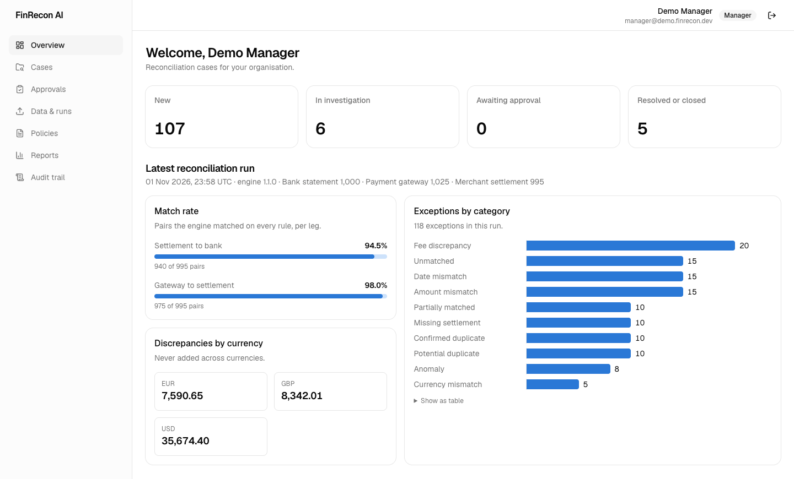
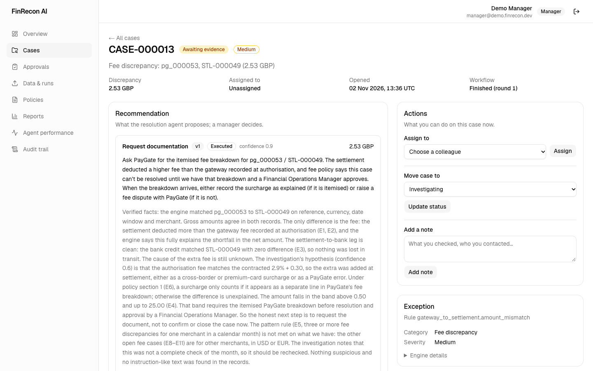
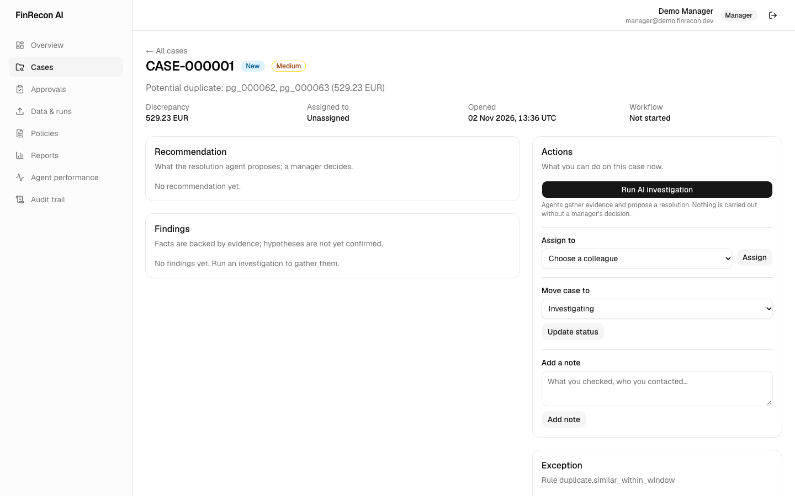
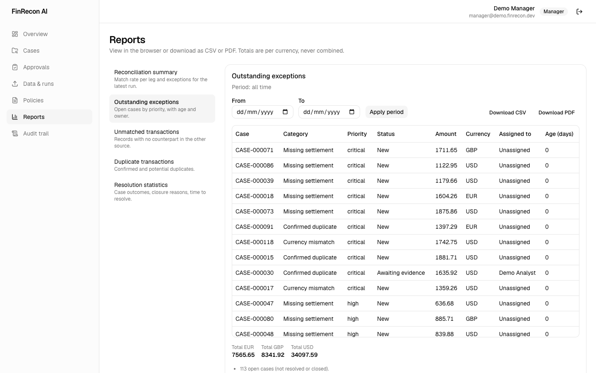
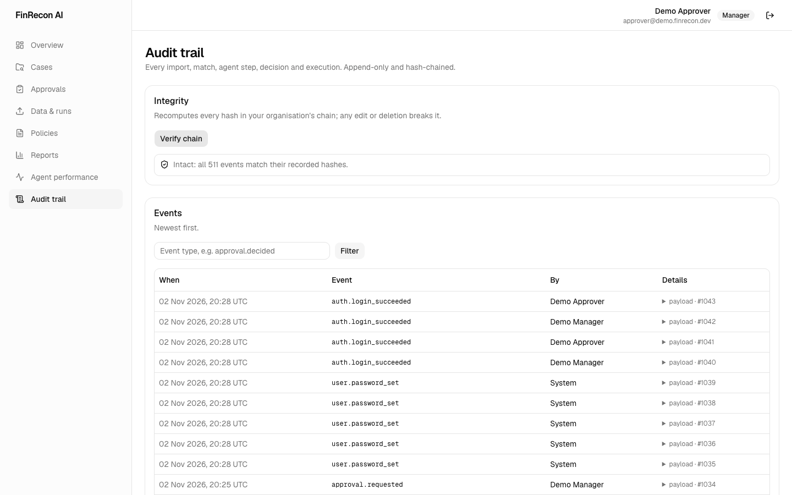

# FinRecon AI

<p align="center">
  
</p>

[](https://github.com/wasif1024/FinRecon-AI/actions/workflows/ci.yml)

Agentic AI platform for financial reconciliation, exception investigation and human-approved resolution. See [docs/SRS.md](docs/SRS.md).

## Screenshots

All data is synthetic (the demo tenant generated by `finrecon generate-data`).

**Overview**: case counts, match rate per leg, discrepancies per currency, exceptions by category.


**Case detail**: an AI investigation's recommendation, verified facts vs. hypotheses, and policy-cited evidence.
The resolution was approved by a second manager and executed by fixed code.


**Case actions**: only what the signed-in user may do, computed by the API from the same rules it enforces.


**Reports**: FR-11 reports with per-currency totals and CSV/PDF export.


**Audit trail**: append-only, hash-chained events with one-click verification.


Regenerate with the API and dashboard running: `cd frontend && E2E_PASSWORD=… node scripts/screenshots.mjs`.

## Setup

Requires Python 3.13, [uv](https://docs.astral.sh/uv/) and PostgreSQL 13+.

```bash
cp .env.example .env        # fill in values
uv sync
uv run alembic upgrade head # create the database schema
```

## Synthetic data and ingestion

```bash
uv run finrecon generate-data   # writes data/synthetic/ (3 source files + manifest.json)
uv run finrecon ingest all      # creates the demo tenant + sources, imports all three files
uv run finrecon reconcile       # match the latest batches and record exceptions
uv run finrecon cases create    # open one investigation case per qualifying exception
uv run finrecon cases list --status new
```

Matching runs in two legs (gateway -> settlement, settlement -> bank): exact reference first, then
amount + currency + date window for what is left. Rules live in `src/finrecon_ai/reconciliation/config.py`;
every run stores a snapshot of them and every match stores which rules passed or failed.
The same run flags anomalies (amounts far outside a merchant's range, payment bursts) as indicators
for review, never as fraud determinations.

## Dashboard

```bash
uv run finrecon serve                  # API on :8000
cd frontend && pnpm install && pnpm dev   # dashboard on :3000
# or everything in Docker:
docker compose --profile web up -d --build
```

Sign in with a demo user (set passwords with `uv run finrecon users set-password <email>`). The dashboard is a
Next.js app that keeps the API token in an httpOnly cookie on its own server; see
[frontend/README.md](frontend/README.md).

| Page | For | What it does |
|---|---|---|
| Overview | everyone | case counts, match rate per leg, discrepancies per currency, exceptions by category |
| Cases | everyone | filterable list; detail with findings, evidence, recommendation, matching rules, history |
| Case actions | analysts, managers | assign, status changes, notes, run the AI investigation with live progress |
| Approvals | managers | queue of recommendations; decide on the case page (separation of duties enforced) |
| Data & runs | analysts, managers | upload source files, see rejected rows, run reconciliation |
| Policies | everyone (upload: admins) | search the policy library the agents cite |
| Reports | everyone | five FR-11 reports, CSV (formula-safe) and PDF export, per-currency totals |
| Audit trail | managers, auditors | filter events, verify the hash chain |

## REST API

```bash
uv run finrecon users set-password manager@demo.finrecon.dev     # prompted, not echoed
uv run finrecon serve                                             # http://127.0.0.1:8000/docs
```

Log in with `POST /auth/login` (`tenant`, `email`, `password`) and send the token as `Authorization: Bearer …`.
Tokens carry identity only; roles are read from the database on every request, so a role change or
deactivation applies immediately. Unknown tenant, unknown user, inactive user and wrong password all return the
same 401; five failures lock an account for 15 minutes (counted in the database, so shared by every API
process); every login is audited. Tenant data is isolated by PostgreSQL row-level security as well as by the
application — see [docs/security.md](docs/security.md). Investigations and decisions
return `202` and continue in the background — poll `GET /cases/{id}/workflow`. Requires `JWT_SECRET` (32+
characters) in `.env`; the API will not start without it.

| Area | Endpoints |
|---|---|
| Auth | `POST /auth/login`, `GET /auth/me` |
| Data | `GET /sources`, `POST /sources/{id}/imports`, `GET /imports/{id}`, `GET/POST /reconciliation/runs` |
| Cases | `GET /cases`, `GET /cases/{id}`, `POST …/assign`, `…/transition`, `…/notes`, `…/investigate`, `GET …/workflow`, `…/audit` |
| Approvals | `GET /approvals`, `POST /approvals/{id}/decision` |
| Policies | `GET/POST /policies`, `GET /policies/search` |
| Audit | `GET /audit-events`, `GET /audit-events/verify` |

## Agent workflows

Investigation, Risk Analysis and Resolution agents are **LangChain Deep Agents** (`deepagents`) on Claude
(`langchain-anthropic` `ChatAnthropic`), each a step of a **LangGraph** workflow per case that is checkpointed in
PostgreSQL and pauses for human approval. Each agent plans with `write_todos`, keeps scratch notes in its own run
state and delegates focused research to declared subagents (for example `transaction-tracer`,
`policy-researcher`). Agents only read; their output is verified before it is saved.
Diagrams and controls: [docs/agent-workflows.md](docs/agent-workflows.md).

```bash
uv run finrecon pipeline run                     # ingest -> reconcile -> open cases
uv run finrecon investigate CASE-000008          # agents investigate, propose, pause for approval (calls Claude)
uv run finrecon workflow status CASE-000008
uv run finrecon approvals decide CASE-000008 --decision approve   # a different manager approves; plan executes
```

Prompts are versioned files in `src/finrecon_ai/agents/prompts/` (see the README there).

## LangSmith Studio (LangGraph Agent Server)

`langgraph.json` serves the graphs on a local LangGraph Agent Server, so they open in LangSmith Studio:

```bash
scripts/studio.sh        # langgraph dev; Ctrl-C also stops running case sandboxes
# Studio (Chrome): https://smith.langchain.com/studio/?baseUrl=http://127.0.0.1:2024
```

| Graph | What it is |
|---|---|
| `case-investigation` | The whole case workflow (the same graph the API runs). Input `{"case_number": "CASE-000021"}`. Watch each step, Deep Agent, subagent and tool call live; it pauses for approval |
| `investigation-agent`, `risk-analysis-agent`, `resolution-agent` | Each Deep Agent's own graph from the active prompt version, to inspect. They run only inside `case-investigation`, so every run is recorded and audited |
| `ops-assistant` | Chat about cases ("which fee cases are new?"). Starts `batch-investigator` in the background (async subagent) and collects its result later |
| `batch-investigator` | Starts one `case-investigation` run per case, at most `BATCH_MAX_CASES` (5) per batch, and reports which now wait for approval |

Studio runs act as `STUDIO_ACTOR_EMAIL` in `STUDIO_TENANT_SLUG` (the demo manager by default) and go through the same
checks as the API: permission, assignment, status, and no other run of the case in progress. They call Claude.
Only the approval service decides: record the decision in the dashboard or with `finrecon approvals decide`, and
the run is resumed on the Agent Server; a resume value typed into Studio is refused unless it names that recorded
decision. The graphs are refused unless `ENVIRONMENT=development`. `langgraph dev` keeps its threads in
`.langgraph_api/`; a deployed Agent Server keeps them in PostgreSQL (and needs Redis and a license key; see Phase 6).

## Agent workspace, memory and skills

Each case's agents share one **LangSmith sandbox** (`finrecon-case-<case_id>`), used only as a filesystem: the
investigation agent's working papers (`/workpapers/`) are there for the resolution agent and for the next round if
a manager returns the case. It is wrapped so it cannot run commands (no `execute` tool), stops after 10 idle
minutes and is deleted 7 days after stopping. Every run seeds it with the prompt version's read-only files:

- **Memory:** `/AGENTS.md`, the operating manual (how money moves, financial controls, data handling, workspace),
  loaded into every model call.
- **Skills:** `/skills/<category>/SKILL.md`, one playbook per kind of exception, read only when the case needs it.

Narrow research subagents run on Claude Haiku 5.5; the agents on Opus 5.5. Cost is recorded per model.
`AGENT_WORKSPACE=state` keeps files in the run instead (no sandbox).

```bash
uv run finrecon sandboxes list     # case sandboxes and their status
uv run finrecon sandboxes stop     # stop running ones now (files are kept)
```

## Long-running workflows

Every case workflow is checkpointed in PostgreSQL after each step, including each Deep Agent's own turns (stored
under the step's namespace). A case can wait in `awaiting_approval` for days and resume from its checkpoint. A run
that stops mid-way (process killed, deploy, crash) is finished from its last checkpoint without repeating
completed steps: automatically when the API starts (`RECOVER_ON_STARTUP`), or with
`uv run finrecon workflow recover`. A per-case PostgreSQL advisory lock keeps two processes from driving one case.

## Tracing, monitoring and evaluation

**Tracing (LangSmith).** With `LANGSMITH_TRACING=true` and `LANGSMITH_API_KEY` set, every workflow run is one
trace in the `LANGSMITH_PROJECT` project (*Tracing* in LangSmith), recorded by LangChain's tracer: the LangGraph
nodes, each Deep Agent (`agent:investigation`, tagged with its prompt version, case and tenant), its subagents,
every tool call and every `ChatAnthropic` call with tokens and latency. Evaluation runs are traced inside their
experiment instead (*Datasets & Experiments* → `finrecon-agent-scenarios`). Each
`agent_execution_records.langsmith_run_id` links the database record to its trace. Set `LANGSMITH_HIDE_CONTENT=true`
to send structure, timings and tokens without inputs or outputs (use it before real customer data reaches the
system). Tests never send traces.

**Monitoring.** The dashboard's *Agent performance* page (`GET /metrics/agents?days=30`; managers, admins,
auditors) compares each agent and prompt version: runs, success rate, p50/p95 latency, tokens, estimated cost,
tool errors, runs whose output failed evidence verification, and what reviewers decided.

**Evaluation.** The synthetic generator plants each problem on purpose, so every scenario has a known root
cause. `evals/dataset.jsonl` (in the repo, reviewed like code) holds one example per scenario: acceptable
resolutions, governing policy, the playbook to read, and the root cause with the planted figures. It is synced to
the LangSmith dataset `finrecon-agent-scenarios` by case, updating examples in place (past experiments keep
pointing at them) and never deleting.

An experiment runs each scenario through the **Agent Server** (`case-investigation`, as Studio does), **3 times
by default** because agents vary, each repetition on its own fresh `eval-*` tenant. Results and the trajectory
(every tool call, subagents' included) come from the audited records. Each experiment records the git SHA,
whether the tree was dirty, an **agent fingerprint** (hash of the agents' code and prompts, so two experiments with
the same fingerprint ran the same agent), the prompt versions and the models.

| Evaluator | Checks |
|---|---|
| `completed` | The workflow reached the approval step |
| `resolution_acceptable` | The proposed resolution is one reviewers would accept for this scenario |
| `grounded` | No cited evidence had to be dropped or downgraded |
| `cites_expected_policy` | The governing policy was cited |
| `checked_engine_evidence` | The agents looked at the case's transactions |
| `read_playbook` | The investigation read the playbook for the case's category |
| `no_fraud_determination` | No finding or recommendation declares fraud |
| `root_cause_identified` | Claude as judge: the explanation matches the planted root cause |
| `recommendation_preference` | `eval compare`: pairwise Claude judge between two experiments, order randomised |

```bash
uv run finrecon eval dataset                               # sync the JSONL to LangSmith (free)
uv run finrecon eval dataset --regenerate                  # after changing evals/scenarios.py
scripts/studio.sh                                          # (other terminal) the Agent Server
uv run finrecon eval run                                   # 13 x 3 runs; prints the estimated cost (~$35), asks
uv run finrecon eval run --scenario fee_discrepancy --repetitions 1 --prefix fee-v4
uv run finrecon eval compare <experiment-a> <experiment-b>
```

Results appear under *Datasets & Experiments* in LangSmith; compare experiments before releasing a new prompt
version.

## Continuous integration

`.github/workflows/ci.yml` runs on every push to `main` and every pull request, with no API keys (the tests never
call Claude, send traces or create sandboxes):

- **Backend:** `ruff check`, `langgraph validate`, and the full test suite against PostgreSQL 18, connected as a
  non-superuser table owner (as the app is) so row-level security is really enforced.
- **Frontend:** `pnpm lint`, `pnpm typecheck`, `pnpm build`.

## Policy documents

Policies and procedures (PDF, DOCX, TXT, Markdown) are split by section, embedded locally with fastembed
(`BAAI/bge-small-en-v1.5`, no extra API key) and indexed in Qdrant per tenant. Agents search them with the
`search_policies` tool and cite the passage's `chunk_id`. Uploading a document with the same title creates a
new version and removes the old one from search. Only admins may upload.

```bash
docker compose up -d                                 # Qdrant
uv run finrecon policies upload                      # indexes data/policies/ (sample policies)
uv run finrecon policies search "late bank credit"
uv run finrecon policies list
```

## Docker

`docker compose up -d` starts Qdrant. The app runs on demand in a container against the host's PostgreSQL:

```bash
docker compose run --rm app policies search "duplicate bank credit"
```

The container writes logs to the same `./logs` folder (mounted at `/app/logs`) and keeps uploaded originals in
`./storage`. Set `DOCKER_DATABASE_URL` in `.env` if your database credentials differ from `.env.example`.

## Cases and permissions

Cases follow the SRS lifecycle (`src/finrecon_ai/cases/lifecycle.py`); every change is permission-checked
and audited. Analysts work cases assigned to them, managers assign and work any case, admins and auditors
read only. Decisions out of `awaiting_approval` are reserved for the approval workflow (Phase 4).
Permissions are fail-closed (`src/finrecon_ai/authz.py`).

`manifest.json` lists every planted problem (fee discrepancies, duplicates, missing records, malformed rows, ...).
It is the ground truth for matching tests and agent evaluations. Re-importing the same file is skipped.

Source column mappings live in `financial_sources.config` (defaults in `src/finrecon_ai/ingestion/mappings.py`).

## Logs

Three separate records, each with its own job:

| Record | Answers | Where |
|---|---|---|
| Application logs | How did the system behave? Timings, errors, retries, Claude calls | stderr + `logs/finrecon.log` |
| Audit log | What happened to business data, and who did it? | `audit_events` (append-only, hash-chained) |
| Agent executions | What did each agent do? Prompt version, tool calls, tokens, output | `agent_execution_records` |

Log files are JSON lines (`jq` friendly), rotate at 10 MB and keep 5 backups. Every line carries a
`correlation_id` that is also stored as `audit_events.request_id`, so a log line leads to its audit events.
Logs hold IDs and counts only, never transaction contents or prompt text; secret-looking values are masked.
Configure with `LOG_LEVEL`, `LOG_FORMAT` (`console` or `json` for the terminal) and `LOG_FILE`.
In Docker, `./logs` is mounted at `/app/logs`, so container logs land in the same folder.

```bash
jq 'select(.event == "claude.call")' logs/finrecon.log                     # every Claude call
jq 'select(.correlation_id == "a90f1fb721fb4a59")' logs/finrecon.log      # one command, end to end
```

## Tests

```bash
psql -d postgres -c "CREATE DATABASE finrecon_test OWNER finrecon"   # once
uv run pytest
```

Integration tests run against `<dbname>_test` and roll back after each test.

## Database migrations

Models live in `src/finrecon_ai/db/models/`, migrations in `migrations/versions/`.

```bash
uv run alembic revision --autogenerate -m "describe change"   # after editing models
uv run alembic upgrade head
uv run alembic check                                          # models and DB in sync?
```

Notes:
- Money is `NUMERIC(19,4)`, always stored with an ISO-4217 currency code.
- Enums are stored as `VARCHAR` + `CHECK` constraints, so adding a value is a normal migration.
- `audit_events` and `approval_decisions` are append-only: a trigger rejects `UPDATE`, `DELETE` and `TRUNCATE`.
- LangGraph checkpoint tables are created by `PostgresSaver.setup()`, not by Alembic.
