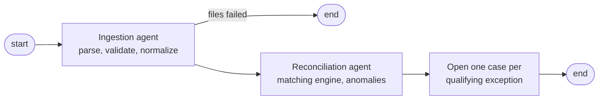
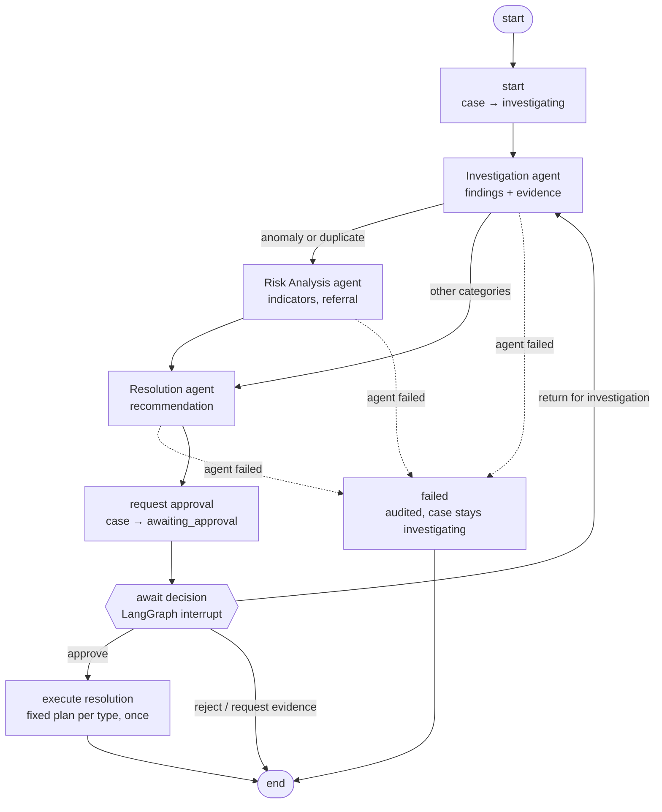
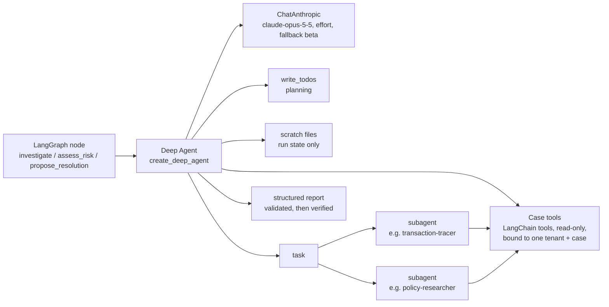

# Agent workflows

FinRecon AI runs two LangGraph workflows. Both keep financial work in deterministic services; models only read
data through allow-listed tools and return structured output that code verifies before saving.

## 1. Reconciliation pipeline (`workflows/reconciliation_pipeline.py`)

SRS §8 steps 1–6. No model is called: the Ingestion and Reconciliation agents (SRS §7.1–7.2) are deterministic
nodes, recorded in `agent_execution_records` and the audit log like every other agent.



`uv run finrecon pipeline run`

## 2. Case investigation (`workflows/case_investigation.py`)

SRS §8 steps 7–10, one thread per case (`case:<case_id>`), checkpointed in PostgreSQL.



### Where runs live, and how they survive restarts

| Started from | Thread | Checkpoints | Approval resumes it via |
|---|---|---|---|
| API, CLI | `case:<case_id>` | PostgreSQL (`PostgresSaver`), with each Deep Agent's turns under its step | `resume_case` here |
| Studio (`langgraph dev`), development only | the Agent Server's thread | the Agent Server | `resume_on_agent_server` (SDK) |

Production runs every workflow in the API process (the first row): the Agent Server is a development tool and is
not deployed. With `ENVIRONMENT=production` (or `AGENT_SERVER_URL` empty) nothing calls one: a thread left from
Studio cannot be running, so that case may start again in the API, and resuming such a thread fails with a clear
error instead of waiting on a server that is not there.

`cases.workflow_thread_id` records which. Before any start, `authorize_start` checks permission, assignment,
status, and that no run of the case is still pending in either place. The paused step accepts only a decision
recorded by the approval service (`recorded_decision`). Interrupted runs (`next` is a step other than
`await_decision`) are finished by `recover_interrupted`: at API startup and via `finrecon workflow recover`.

### Inside each agent step: a Deep Agent (`agents/runtime.py`)

Each agent node runs one LangChain Deep Agent, built from the active prompt version
(`agents/prompts/<agent>/<version>/manifest.yaml`):



| Agent (Opus 5.5) | Subagents (Haiku 5.5, own tool allow-list) | Skills |
|---|---|---|
| Investigation | `transaction-tracer` (search_transactions, get_counterparty_history, get_match_explanation), `policy-researcher` (search_policies) | all 8 |
| Risk Analysis | `pattern-analyst` (get_counterparty_history, search_transactions, find_similar_cases) | duplicates, anomaly-indicators |
| Resolution | `policy-researcher` (search_policies) | all 8 |

Files: the case's LangSmith sandbox (`agents/workspace.py`), seeded each run with the read-only `/AGENTS.md`
memory and `/skills/`; working papers in `/workpapers/` carry across agents and rounds. Removed from the harness:
`execute` (the sandbox is wrapped as files only) and the general-purpose subagent that would inherit every tool.
Limits: model turns per agent and per subagent (`max_turns`), tool results over 20,000 characters refused.

```bash
uv run finrecon investigate CASE-000008                              # runs agents, pauses
uv run finrecon approvals list
uv run finrecon approvals decide CASE-000008 --decision approve      # a different manager decides
```

### Decisions (`approvals/service.py`) and execution (`approvals/executor.py`)

| Decision | Case moves to | Recommendation | Workflow |
|---|---|---|---|
| approve | approved, then resolved or awaiting evidence | executed | runs the execution plan, ends |
| reject | rejected | rejected | ends |
| request evidence | awaiting evidence | superseded | ends |
| return for investigation | investigating | superseded | agents run again with the comment |

Execution plans: `confirm_fee_discrepancy` and `no_action_required` resolve the case and exception;
`manual_match` also creates an approved manual match; `request_documentation`, `investigate_duplicate` and
`escalate` record the follow-up steps and leave the case awaiting evidence. Nothing moves money.

A decision is committed before the workflow resumes; `finrecon approvals resume` resumes any whose resume did
not complete. Execution runs at most once (unique execution key) and a retry returns the recorded result.

### What makes agent output trustworthy

| Control | Where |
|---|---|
| Tools are read-only, bound to one tenant and one case, allow-listed per prompt version | `agents/tools.py`, prompt manifests |
| Every cited ID must be one a tool returned in that run; otherwise it is dropped | `agents/persistence.py` |
| A "verified fact" whose evidence was dropped is stored as a hypothesis, marked `[Unverified…]` | `agents/persistence.py` |
| Recommendation amounts and currencies come from the matching engine, not the model | `agents/persistence.py` |
| Everything rejected is listed in the audit event and the workflow state | `agent.findings_recorded`, `rejected_output` |
| Decisions out of `awaiting_approval` only through the approval service; `resolved` only by execution | `cases/lifecycle.py` |
| Whoever started the investigation cannot decide it; one immutable decision per request | `approvals/service.py`, DB constraint + trigger |
| Transient API errors retried (3 attempts, backoff); other failures end the run, audited | `AGENT_RETRY`, `failed` node |
| Each run records its exact prompt (`agent@version#hash`), tool calls (subagents' included) and tokens | `agent_execution_records` |
| Every tool call, including Deep Agents' own tools and subagents', is audited | `ToolAuditMiddleware`, `agent.tool_invoked` |
| No shell, no catch-all subagent; scratch files live only in the run's state | `HARNESS_PROFILE`, `test_tool_abuse.py` |
| Each run is traced in LangSmith (LangChain tracer) and linked by `langsmith_run_id`; content can be hidden | `agents/runtime.py`, `tracing.py` |
| Prompt versions are compared on live metrics and on planted-scenario experiments | `agents/metrics.py`, `evals/` |
