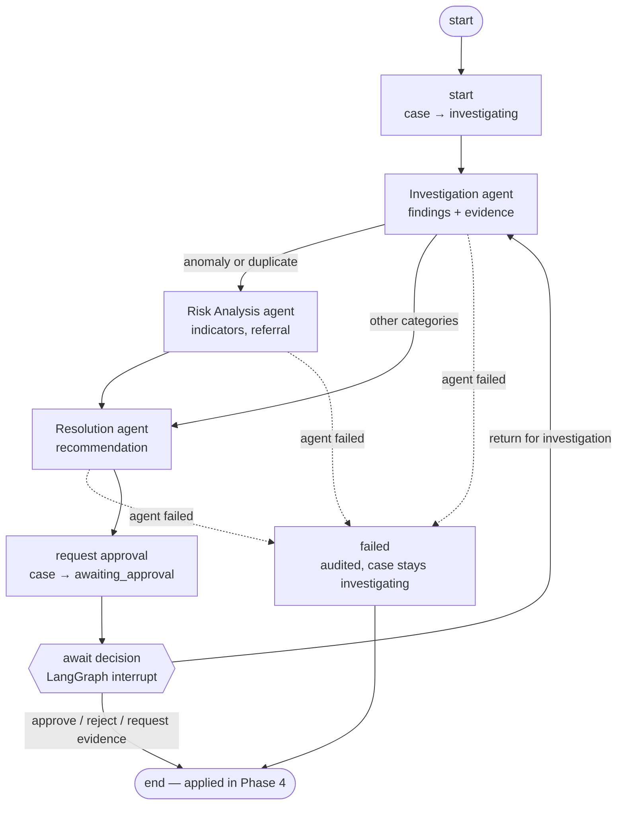

# Agent workflows

FinRecon AI runs two LangGraph workflows. Both keep financial work in deterministic services; models only read
data through allow-listed tools and return structured output that code verifies before saving.

## 1. Reconciliation pipeline (`workflows/reconciliation_pipeline.py`)

SRS §8 steps 1–6. No model is called: the Ingestion and Reconciliation agents (SRS §7.1–7.2) are deterministic
nodes, recorded in `agent_execution_records` and the audit log like every other agent.

`uv run finrecon pipeline run`

## 2. Case investigation (`workflows/case_investigation.py`)

SRS §8 steps 7–10, one thread per case (`case:<case_id>`), checkpointed in PostgreSQL.

`uv run finrecon investigate CASE-000008` then `uv run finrecon workflow status CASE-000008`

### What makes agent output trustworthy

| Control | Where |
|---|---|
| Tools are read-only, bound to one tenant and one case, allow-listed per prompt version | `agents/tools.py`, prompt manifests |
| Every cited ID must be one a tool returned in that run; otherwise it is dropped | `agents/persistence.py` |
| A "verified fact" whose evidence was dropped is stored as a hypothesis, marked `[Unverified…]` | `agents/persistence.py` |
| Recommendation amounts and currencies come from the matching engine, not the model | `agents/persistence.py` |
| Everything rejected is listed in the audit event and the workflow state | `agent.findings_recorded`, `rejected_output` |
| Decisions out of `awaiting_approval` only through the approval workflow | `cases/lifecycle.py` |
| Transient API errors retried (3 attempts, backoff); other failures end the run, audited | `AGENT_RETRY`, `failed` node |
| Each run records its exact prompt (`agent@version#hash`), tool calls and tokens | `agent_execution_records` |
