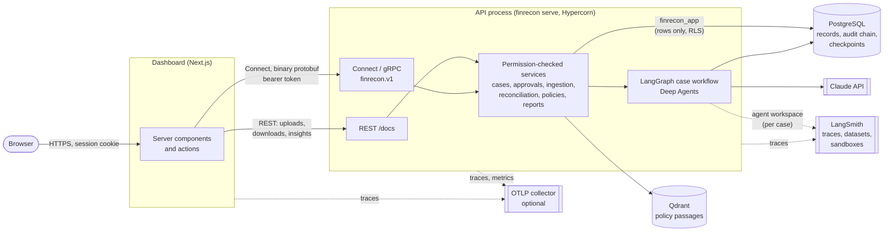
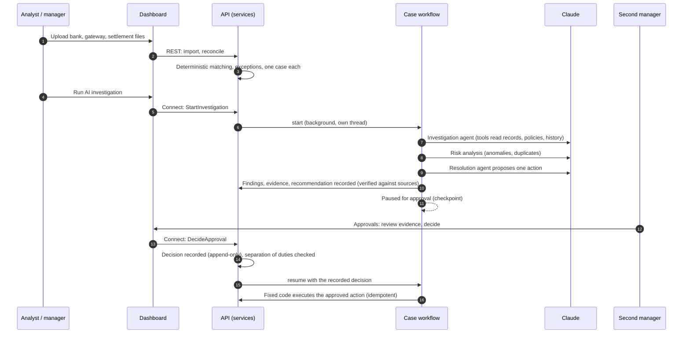
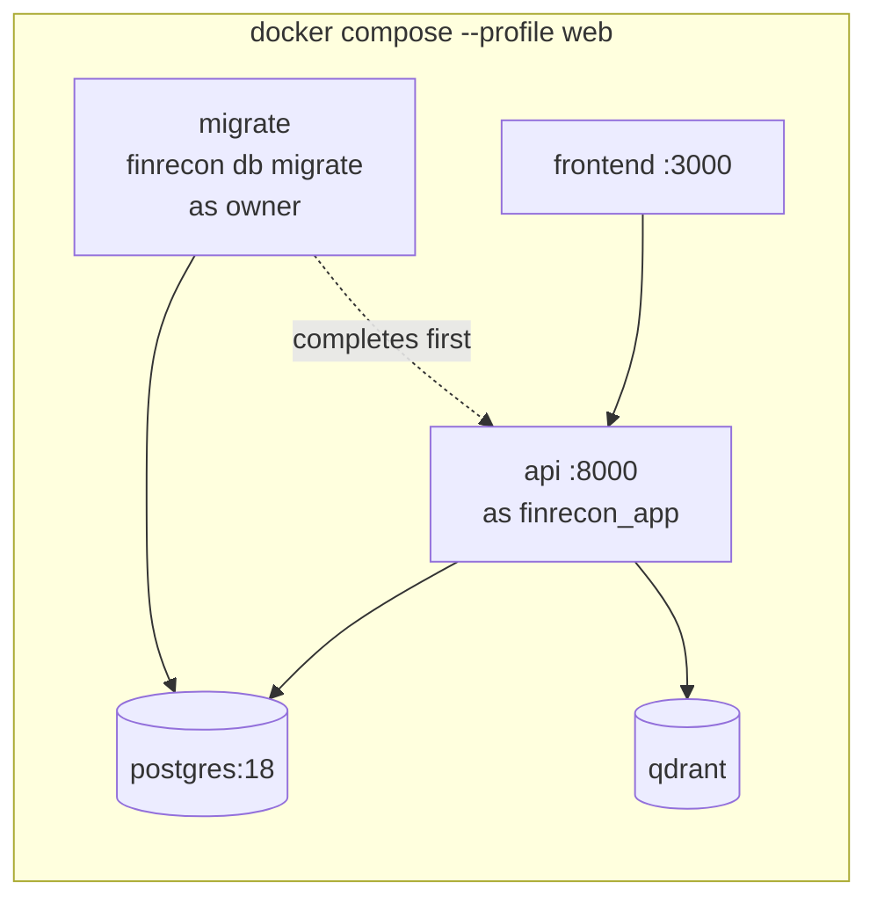

# Architecture

How FinRecon AI is put together: the services, how a case moves through them, and where each guarantee lives.
Requirements are in [SRS.md](SRS.md); the agent workflow in detail is in [agent-workflows.md](agent-workflows.md);
controls and their tests are in [security.md](security.md).

## Services

- **The browser only talks to the dashboard.** The API token lives in an httpOnly cookie on the Next.js server,
  which calls the API server-to-server.
- **One API process, three protocols.** The case work (identity, cases, workflow, approvals) has a typed contract in
  [`proto/finrecon/v1`](../proto/finrecon/v1), served as Connect and gRPC beside the REST API on the same port.
  Each RPC calls the same function as its REST endpoint, so there is one implementation of every rule.
- **Agent runs happen inside the API process.** A case workflow is a LangGraph graph whose agent steps are LangChain
  Deep Agents calling Claude. Runs are durable without a separate server (PostgreSQL checkpoints, startup recovery,
  one run per case). The LangGraph Agent Server is a development tool: LangSmith Studio, the coordinator agents and
  evaluation experiments ([SRS §9](SRS.md)).
- **PostgreSQL is the system of record.** Financial records, cases, findings, decisions, the audit chain and
  LangGraph's checkpoints. Qdrant only holds policy passages for search; it can be rebuilt from the stored files.

## A case, end to end

Nothing an agent writes takes effect by itself: agents read through tools and record findings and a proposal; the
only path to an action is a recorded human decision, and the action is carried out by fixed code, not by a model.

## Where each guarantee lives

| Guarantee | Mechanism | Code |
|---|---|---|
| Matching is reproducible and explained | Deterministic engine, rule-by-rule explanation per match | `reconciliation/` |
| Agent claims are grounded | Findings must cite evidence the run actually saw; unverifiable claims are rejected or marked | `agents/persistence.py` |
| Humans decide | Workflow pauses; resume accepts only a recorded decision; the starter may not approve | `workflows/case_investigation.py`, `approvals/` |
| Actions are safe to retry | Execution keyed by recommendation, recorded once | `approvals/executor.py` |
| Tenants are isolated | Application scoping, forced row-level security, and an API login that owns nothing | `db/tenancy.py`, `db/roles.py`, migrations 0005, 0007 |
| History cannot be rewritten | Append-only audit events and decisions (trigger and revoked privileges), SHA-256 hash chain | `audit.py`, migration 0001 |
| Runs survive restarts | PostgreSQL checkpoints, recovery sweep at startup, per-case advisory lock, pause rebuilt from records if a checkpoint is lost | `workflows/case_investigation.py` |
| Behaviour is observable | LangSmith (agent view), OpenTelemetry (service view), structured logs with trace ids | `tracing.py`, `telemetry.py`, `log.py` |
| Agents are regression-tested | Planted-scenario dataset, code and LLM-judge evaluators, experiments by agent fingerprint | `evals/` |

## Deployment

Two database logins: the owner (`MIGRATION_DATABASE_URL`) runs migrations, LangGraph's checkpoint setup and grants;
the API connects as `finrecon_app`, which reads and writes rows only. CI builds both images, starts this stack,
loads the demo snapshot and runs the browser suite against it. See the README's Docker and Database logins sections.

## Repository map

| Path | What |
|---|---|
| `src/finrecon_ai/api/` | FastAPI app, REST routes, Connect/gRPC services (`rpc.py`) |
| `src/finrecon_ai/workflows/` | The LangGraph case workflow |
| `src/finrecon_ai/agents/` | Deep Agent runtime, tools, versioned prompts, memory and skills |
| `src/finrecon_ai/{ingestion,reconciliation,cases,approvals,policies,reports}/` | Domain services |
| `src/finrecon_ai/db/` | Models, tenancy (RLS), database logins |
| `src/finrecon/` | Code generated from `proto/` |
| `frontend/` | Next.js dashboard; `src/gen/` generated from `proto/` |
| `migrations/` | Alembic migrations |
| `evals/`, `src/finrecon_ai/evals/` | LangSmith dataset and experiment harness |
| `demo/` | The demo snapshot (`scripts/demo.sh`) |
| `docker/`, `docker-compose.yml`, `Dockerfile`s | Containers |
