# Database ER diagram

Generated from the SQLAlchemy models by `uv run finrecon docs er` (`src/finrecon_ai/db/er.py`); the test suite
fails if it falls behind them. Migrations are in `migrations/versions/`.

| Area | Tables |
|---|---|
| Tenancy and identity | `tenants`, `users`, `roles`, `user_roles` |
| Financial data | `financial_sources`, `import_batches`, `transactions` |
| Reconciliation | `reconciliation_runs`, `transaction_matches`, `transaction_match_items`, `reconciliation_exceptions`, `exception_transactions` |
| Investigation | `investigation_cases`, `agent_execution_records`, `investigation_evidence`, `investigation_findings`, `policy_documents` |
| Governance | `resolution_recommendations`, `approval_requests`, `approval_decisions`, `audit_events` |

Every table except `tenants`, `roles` and the link tables carries `tenant_id` (a foreign key to `tenants`, not
drawn below to keep the diagram readable) and is protected by forced row-level security
(migration 0005; link tables follow their parent row). `audit_events` and `approval_decisions` are append-only
(trigger and revoked privileges) and the audit events form a SHA-256 hash chain per tenant. Money is
`numeric(19,4)` with an ISO-4217 currency; enums are stored as `varchar` with a `CHECK` constraint.

LangGraph's checkpoint tables (`checkpoints`, `checkpoint_blobs`, `checkpoint_writes`, `checkpoint_migrations`)
live in the same database, keyed by thread id (`case:<case_id>` for the case workflow); they are created by
LangGraph's `PostgresSaver`, not by these models.

```mermaid
erDiagram
  agent_execution_records {
    enum agent_name
    enum status
    uuid case_id FK "nullable"
    uuid run_id FK "nullable"
    uuid parent_execution_id FK "nullable"
    varchar_200 workflow_thread_id  "nullable"
    varchar_50 workflow_version
    varchar_200 langsmith_run_id  "nullable"
    varchar_100 model  "nullable"
    jsonb input
    jsonb output  "nullable"
    jsonb tool_calls
    int input_tokens  "nullable"
    int output_tokens  "nullable"
    jsonb usage_by_model
    text error  "nullable"
    timestamptz started_at
    timestamptz completed_at  "nullable"
    uuid id PK
    uuid tenant_id FK
  }
  approval_decisions {
    uuid approval_request_id FK,UK
    uuid reviewer_id FK
    enum decision
    text comments  "nullable"
    array evidence_considered_ids
    jsonb original_recommendation
    jsonb final_action  "nullable"
    timestamptz decided_at
    uuid id PK
    uuid tenant_id FK
  }
  approval_requests {
    uuid case_id FK
    uuid recommendation_id FK
    enum status
    enum required_role
    uuid requested_by_user_id FK "nullable"
    uuid requested_by_agent_execution_id FK "nullable"
    varchar_200 workflow_thread_id
    varchar_200 workflow_checkpoint_id  "nullable"
    timestamptz due_at  "nullable"
    uuid id PK
    uuid tenant_id FK
    timestamptz created_at
    timestamptz updated_at
  }
  audit_events {
    bigint id PK
    timestamptz occurred_at
    varchar_100 event_type
    enum actor_type
    uuid actor_user_id FK "nullable"
    uuid agent_execution_id FK "nullable"
    varchar_100 entity_type
    varchar_100 entity_id  "nullable"
    jsonb payload
    varchar_100 request_id  "nullable"
    inet ip_address  "nullable"
    varchar_64 prev_hash  "nullable"
    varchar_64 hash
    uuid tenant_id FK
  }
  exception_transactions {
    uuid exception_id PK,FK
    uuid transaction_id PK,FK
  }
  financial_sources {
    varchar_200 name
    enum source_type
    enum ingestion_method
    jsonb config
    bool is_active
    uuid id PK
    uuid tenant_id FK
    timestamptz created_at
    timestamptz updated_at
  }
  import_batches {
    uuid source_id FK
    varchar_500 file_name
    enum file_format
    varchar_64 file_sha256
    text storage_uri  "nullable"
    enum status
    int total_records
    int accepted_records
    int rejected_records
    jsonb validation_errors
    uuid uploaded_by FK "nullable"
    timestamptz started_at  "nullable"
    timestamptz completed_at  "nullable"
    uuid id PK
    uuid tenant_id FK
    timestamptz created_at
    timestamptz updated_at
  }
  investigation_cases {
    varchar_50 case_number
    uuid exception_id FK,UK
    enum status
    enum priority
    varchar_300 title
    numeric_19_4 discrepancy_amount  "nullable"
    varchar_3 currency  "nullable"
    uuid assigned_to FK "nullable"
    uuid created_by FK "nullable"
    varchar_200 workflow_thread_id UK "nullable"
    timestamptz resolved_at  "nullable"
    timestamptz closed_at  "nullable"
    enum closure_reason  "nullable"
    uuid id PK
    uuid tenant_id FK
    timestamptz created_at
    timestamptz updated_at
  }
  investigation_evidence {
    uuid case_id FK
    enum evidence_type
    uuid transaction_id FK "nullable"
    uuid policy_document_id FK "nullable"
    uuid related_case_id FK "nullable"
    jsonb source_reference
    text excerpt  "nullable"
    uuid collected_by_user_id FK "nullable"
    uuid agent_execution_id FK "nullable"
    timestamptz created_at
    uuid id PK
    uuid tenant_id FK
  }
  investigation_findings {
    uuid case_id FK
    uuid agent_execution_id FK "nullable"
    enum finding_type
    text statement
    numeric_5_4 confidence  "nullable"
    array evidence_ids
    timestamptz created_at
    uuid id PK
    uuid tenant_id FK
  }
  policy_documents {
    varchar_300 title
    varchar_500 file_name
    varchar_150 mime_type
    varchar_64 file_sha256
    text storage_uri
    int version
    enum status
    varchar_200 qdrant_collection  "nullable"
    int chunk_count
    text error  "nullable"
    uuid uploaded_by FK "nullable"
    timestamptz indexed_at  "nullable"
    uuid id PK
    uuid tenant_id FK
    timestamptz created_at
    timestamptz updated_at
  }
  reconciliation_exceptions {
    uuid run_id FK
    uuid match_id FK "nullable"
    enum category
    enum severity
    enum status
    numeric_19_4 discrepancy_amount  "nullable"
    varchar_3 currency  "nullable"
    varchar_100 rule_code  "nullable"
    jsonb details
    uuid id PK
    uuid tenant_id FK
    timestamptz created_at
    timestamptz updated_at
  }
  reconciliation_runs {
    varchar_200 idempotency_key
    enum status
    jsonb config
    varchar_50 engine_version
    jsonb import_batch_ids
    jsonb summary
    uuid started_by FK "nullable"
    timestamptz started_at  "nullable"
    timestamptz completed_at  "nullable"
    string error  "nullable"
    uuid id PK
    uuid tenant_id FK
    timestamptz created_at
    timestamptz updated_at
  }
  resolution_recommendations {
    uuid case_id FK
    int version
    enum resolution_type
    enum status
    text summary
    text rationale
    jsonb proposed_action
    numeric_5_4 confidence  "nullable"
    uuid agent_execution_id FK "nullable"
    varchar_200 execution_idempotency_key UK "nullable"
    timestamptz executed_at  "nullable"
    jsonb execution_result  "nullable"
    uuid id PK
    uuid tenant_id FK
    timestamptz created_at
    timestamptz updated_at
  }
  roles {
    enum name UK
    text description  "nullable"
    uuid id PK
  }
  tenants {
    varchar_200 name
    varchar_100 slug UK
    uuid id PK
    timestamptz created_at
    timestamptz updated_at
  }
  transaction_match_items {
    uuid match_id PK,FK
    uuid transaction_id PK,FK
  }
  transaction_matches {
    uuid run_id FK
    enum classification
    enum strategy
    numeric_5_4 score
    numeric_19_4 amount_difference  "nullable"
    varchar_3 currency  "nullable"
    jsonb explanation
    timestamptz created_at
    uuid id PK
    uuid tenant_id FK
  }
  transactions {
    uuid source_id FK
    uuid import_batch_id FK
    bigint source_row_number
    varchar_200 source_transaction_id  "nullable"
    varchar_200 external_reference  "nullable"
    date transaction_date
    timestamptz transaction_timestamp  "nullable"
    date settlement_date  "nullable"
    numeric_19_4 amount
    numeric_19_4 fee_amount  "nullable"
    varchar_3 currency
    enum direction
    varchar_300 counterparty  "nullable"
    varchar_300 merchant  "nullable"
    text description  "nullable"
    enum status
    varchar_64 fingerprint
    jsonb raw_payload
    uuid id PK
    uuid tenant_id FK
    timestamptz created_at
    timestamptz updated_at
  }
  user_roles {
    uuid user_id PK,FK
    uuid role_id PK,FK
  }
  users {
    varchar_320 email
    varchar_200 full_name
    varchar_255 password_hash  "nullable"
    bool is_active
    uuid id PK
    uuid tenant_id FK
    timestamptz created_at
    timestamptz updated_at
  }
  investigation_cases o|--o{ agent_execution_records : "case_id"
  reconciliation_runs o|--o{ agent_execution_records : "run_id"
  agent_execution_records o|--o{ agent_execution_records : "parent_execution_id"
  approval_requests ||--o{ approval_decisions : "approval_request_id"
  users ||--o{ approval_decisions : "reviewer_id"
  investigation_cases ||--o{ approval_requests : "case_id"
  resolution_recommendations ||--o{ approval_requests : "recommendation_id"
  users o|--o{ approval_requests : "requested_by_user_id"
  agent_execution_records o|--o{ approval_requests : "requested_by_agent_execution_id"
  users o|--o{ audit_events : "actor_user_id"
  agent_execution_records o|--o{ audit_events : "agent_execution_id"
  reconciliation_exceptions ||--o{ exception_transactions : "exception_id"
  transactions ||--o{ exception_transactions : "transaction_id"
  financial_sources ||--o{ import_batches : "source_id"
  users o|--o{ import_batches : "uploaded_by"
  reconciliation_exceptions ||--o{ investigation_cases : "exception_id"
  users o|--o{ investigation_cases : "assigned_to"
  users o|--o{ investigation_cases : "created_by"
  investigation_cases ||--o{ investigation_evidence : "case_id"
  transactions o|--o{ investigation_evidence : "transaction_id"
  policy_documents o|--o{ investigation_evidence : "policy_document_id"
  investigation_cases o|--o{ investigation_evidence : "related_case_id"
  users o|--o{ investigation_evidence : "collected_by_user_id"
  agent_execution_records o|--o{ investigation_evidence : "agent_execution_id"
  investigation_cases ||--o{ investigation_findings : "case_id"
  agent_execution_records o|--o{ investigation_findings : "agent_execution_id"
  users o|--o{ policy_documents : "uploaded_by"
  reconciliation_runs ||--o{ reconciliation_exceptions : "run_id"
  transaction_matches o|--o{ reconciliation_exceptions : "match_id"
  users o|--o{ reconciliation_runs : "started_by"
  investigation_cases ||--o{ resolution_recommendations : "case_id"
  agent_execution_records o|--o{ resolution_recommendations : "agent_execution_id"
  transaction_matches ||--o{ transaction_match_items : "match_id"
  transactions ||--o{ transaction_match_items : "transaction_id"
  reconciliation_runs ||--o{ transaction_matches : "run_id"
  financial_sources ||--o{ transactions : "source_id"
  import_batches ||--o{ transactions : "import_batch_id"
  users ||--o{ user_roles : "user_id"
  roles ||--o{ user_roles : "role_id"
```

